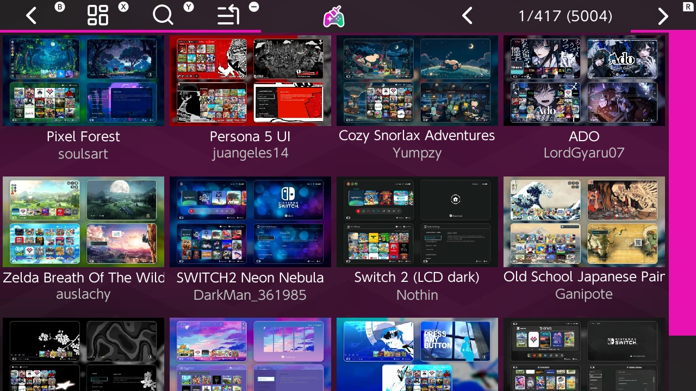

# themezer-nx
A switch theme downloader that pulls from https://themezer.net/, and installs themes using the NXThemesInstaller

## How to use
1. Download the latest nro release in the [releases tab](https://github.com/ThemezerNX/Themezer-NX/releases) and put it in the switch folder 
2. Download the latest [NXThemesInstaller.nro](https://github.com/exelix11/SwitchThemeInjector/releases) and put it in the switch folder, if you haven't already. (The releases from the appstore should work as well)
3. Make sure your switch is connected to the internet (if you're looking to connect online without connecting to nintendo, see [90DNS](https://nh-server.github.io/switch-guide/extras/blocking_updates/))
4. Open the app in the homebrew menu

## "Installing" a Theme
Installing a theme or a splash queues it (- shows the queue). When you exit through the + menu, themezer-nx opens the NXThemesInstaller to install what's queued.

## Building
`make` with devkitPro (devkitA64, libnx and the switch-curl, switch-sdl2, switch-sdl2_image and switch-sdl2_ttf portlibs) builds `themezer-nx/themezer-nx.nro`. To look at the UI on a computer, `make -C themezer-nx/desktop` builds it with SDL2 there (see the top of `themezer-nx/desktop/switch.cpp`).

## Support
For support you can go to the [Themezer discord](https://discord.gg/bBCw6tF)

## Credits
- [Exelix11](https://github.com/exelix11) for helping me with cURL and being awesome in general
- [cJSON](https://github.com/DaveGamble/cJSON) For the json lib used in this project
- [Themezer-3DS](https://github.com/ThemezerNX/Themezer-3DS) for the look, the sounds and the music
- [Lucide](https://lucide.dev) for the icons

## Error reports

Errors reading or writing storage (except a full SD card), invalid data, and unsupported data offer **Share error** on Y.
Nothing is sent unless you press it. The report contains exactly the app version, firmware display version,
Atmosphère version, error kind, displayed message, diagnostic detail, and recent log lines (which may include file paths).
It contains no console or user identifiers. Themezer only logs the report; it does not open a ticket.
For bug reports, the current session log is `/Themes/ThemezerNX/log.txt`; the previous session is `log.old.txt` in the same folder.
