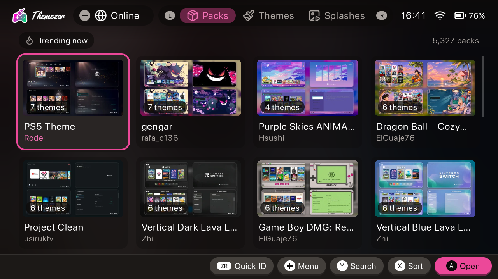

# Themezer-NX

A theme manager for the Nintendo Switch by [Themezer](https://themezer.net). Browse themes, splashes and packs from Themezer, or manage the ones on your SD card, then install them with NXThemesInstaller. Search, sort and filter, or use an item's Quick ID.


<p>

  

</p>

## Installing

1. There are two ways to install it:
   - **Homebrew App Store:** search for **ThemezerNX** in the [Homebrew App Store](https://hb-app.store/switch/ThemezerNX) and install it.
   - **Manually:** download `themezer-nx.nro` from the [releases](https://github.com/ThemezerNX/Themezer-NX/releases) and put it in `/switch/` on your SD card.
2. Then open Themezer-NX in the Homebrew Menu. Your Switch needs to be connected to the internet. To connect online without connecting to Nintendo, see [90DNS](https://nh-server.github.io/switch-guide/extras/blocking_updates/).

Themes and splashes are installed through [NXThemesInstaller](https://github.com/exelix11/SwitchThemeInjector/releases). If it isn't on the SD card, Themezer-NX offers to download it for you. Alternatively you can download that application via the Homebrew App Store as well, or put `NXThemesInstaller.nro` in `/switch/` yourself.

## Using it

- **Installing:** Press A on a theme to open its install sheet. **Install & Save** keeps a copy in `/Themes/ThemezerNX`, **Install only** uses a temporary copy, and **Download only** saves a copy without installing it. A pack's X opens the same choices for all its themes: **Install & Save All**, **Install All only** and **Download All only**. Installing queues the item. When you exit through the + menu, Themezer-NX opens NXThemesInstaller to install what's queued. A queued item's A (or a queued pack's X) says **Cancel install** and takes it out of the queue.
- **Packs:** A pack is a set of themes. Install or download them all at once from its page.
- **SD card:** The themes, splashes and packs already on your SD card are listed too, and you can manage them from the app.
- **Updates:** Themezer-NX checks for updates to itself and NXThemesInstaller when it starts, and checks the themes, splashes and packs on your SD card against Themezer (turn that off under Settings in the + menu). An update is one press away, and the app shows what's new before you install it.

## Building

You need [devkitPro](https://devkitpro.org/wiki/Getting_Started) with devkitA64, and these packages (`switch-dev` includes libnx):

```sh
dkp-pacman -S switch-dev switch-curl switch-mbedtls switch-sdl2 switch-sdl2_image switch-sdl2_ttf
```

Then:

```sh
make                              # themezer-nx/themezer-nx.nro and themezer-nx.elf
make -C themezer-nx/desktop       # the app for your computer, with SDL2
make -C themezer-nx/desktop test  # unit tests, on your computer
make -C themezer-nx update-certs  # the newest Mozilla CA list, from curl.se
```

To look at the UI on a computer, run `./desktop/themezer-nx-desktop` from `themezer-nx/`, where `romfs:` is. The desktop build needs SDL2, SDL2_image, SDL2_ttf and curl, and its Makefile looks for SDL2 under `/opt/homebrew`.

CI runs the unit tests and builds on every push, refreshing the CA list before each build and failing if the licence notices are out of date (`tools/make_licenses.py` regenerates them). A `vX.Y.Z` tag publishes a release with the `.nro` and a zipped `.elf`, which has the debug info for looking up a crash's addresses.

## Support

For support, join the [Themezer Discord](https://discord.gg/bBCw6tF).

## Privacy

Apart from the checks below, Themezer-NX sends nothing on its own. It talks to Themezer only for what you ask for: listing, searching and downloading.

The checks are:

- Each time it starts, it asks GitHub for the latest releases of Themezer-NX and NXThemesInstaller. You can turn this off under Settings in the '+' menu.
- Each time it starts, it sends Themezer the Quick ID and version of each theme, splash and pack on your SD card, to see which have updates, so Themezer learns which items you have. You can turn this off under Settings in the '+' menu.
- If the SD card has downloads from Themezer-NX v3, it sends Themezer their old IDs at start, until Themezer has answered once, to give them their current names. The setting above doesn't stop this one.

When an error comes from storage (other than a full SD card), from running out of memory, or from invalid or unsupported data, the error dialog has **Share error** on Y. Only if you press it does the app send Themezer the app's version, the firmware and Atmosphère versions, how the app was launched, its memory use, the error, and the recent log lines, which may include file paths. The report holds no ID of you or your console, and Themezer only keeps it to look the error up. Development builds (versions with `-dev`) never send error reports. The code is in `themezer-nx/source/services/reporter.cpp`.

After a crash, a freeze or a fatal error, the next start asks once whether to share that session. If you say yes, the report has the app's version, launch mode, memory, the session's log, and a short excerpt of the crash's registers and module offsets. The snapshot is kept in `/Themes/ThemezerNX/last-session.txt`. The session's log is `/Themes/ThemezerNX/log.txt`, and the previous session's is `log.old.txt`.

HTTPS servers are checked against the Mozilla CA list bundled with the app. Once that list is more than 1,096 days old, a certificate failure causes one retry without verification, and verification stays off for the rest of that session.

## LLM use

Themezer-NX v4 was programmed with the help of an LLM (Claude): most of its code and docs were written with it, then reviewed and tested on real consoles.

The background music, "Aether", was generated with [Suno](https://suno.com).

## License

Themezer-NX is free software, distributed under the [GNU General Public License v3.0](LICENSE). The libraries it's built with keep their own licenses; see [THIRD_PARTY_NOTICES.md](THIRD_PARTY_NOTICES.md).

## Credits

Themezer-NX's versions were made by:

- **v1 and v2:** suchmememanyskill
- **v3:** suchmememanyskill and [Migush](https://github.com/migushthe2nd)
- **v4:** [Migush](https://github.com/migushthe2nd)

Thanks to [Exelix11](https://github.com/exelix11) for NXThemesInstaller and for help with cURL, to [cJSON](https://github.com/DaveGamble/cJSON) for the JSON library, and to [Lucide](https://lucide.dev) for the icons.